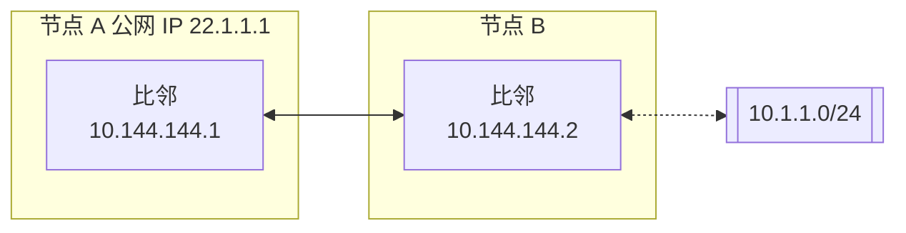
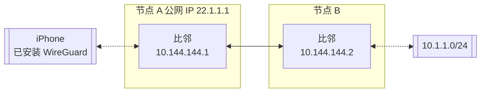

# 比邻


[](https://github.com/AmashiroNatsuki250/Bilin/releases)
[](LICENSE)
[](https://github.com/AmashiroNatsuki250/Bilin/commits/main)
[](https://github.com/AmashiroNatsuki250/Bilin/issues)
[](https://github.com/AmashiroNatsuki250/Bilin/actions/workflows/core.yml)
[](https://github.com/AmashiroNatsuki250/Bilin/actions/workflows/gui.yml)
[](https://github.com/AmashiroNatsuki250/Bilin/actions/workflows/test.yml)

[简体中文](/README_CN.md) | [English](/README.md)

> ✨ 一个由 Rust 和 Tokio 驱动的简单、安全、去中心化的异地组网方案

比邻包含桌面与移动客户端、组网节点和 Web 控制台。

[比邻 Web 控制台，使用示例数据](assets/web-console-overview.png) · [网络成员](assets/web-console-members.png)

## 特性

### 核心特性

- 🔒 **去中心化**：节点平等且独立，无需中心化服务
- 🚀 **易于使用**：支持通过网页、客户端和命令行多种操作方式
- 🌍 **跨平台**：支持 Win/MacOS/Linux/FreeBSD/Android 和 X86/ARM/MIPS 架构
- 🔐 **安全**：AES-GCM 或 WireGuard 加密，防止中间人攻击

### 高级功能

- 🔌 **高效 NAT 穿透**：支持 UDP 和 IPv6 穿透，可在 NAT4-NAT4 网络中工作
- 🌐 **子网代理**：节点可以共享子网供其他节点访问
- 🔄 **智能路由**：延迟优先和自动路由选择，提供最佳网络体验
- ⚡ **高性能**：整个链路零拷贝，支持 TCP/UDP/WSS/WG 协议

### 网络优化

- 📊 **UDP 丢包抗性**：KCP/QUIC 代理在高丢包环境下优化延迟和带宽
- 🔧 **Web 管理**：通过 Web 界面轻松配置和监控
- 🛠️ **零配置**：静态链接的可执行文件，简单部署

## 快速开始

[自建 STUN、中继和 Web 控制台](docs/deploy-bilin.md)

### 📥 安装

选择最适合您需求的安装方式：

Linux（推荐）：
```bash
curl -fsSL "https://github.com/AmashiroNatsuki250/Bilin/blob/main/script/install.sh?raw=true" | sudo bash -s install
```

Homebrew（MacOS/Linux）：
```bash
brew tap brewforge/chinese
brew install --cask bilin-gui
```

Windows（推荐，请以管理员权限运行）：
```powershell
irm "https://github.com/AmashiroNatsuki250/Bilin/blob/main/script/install.ps1?raw=true" | iex
```

通过 cargo 安装（最新开发版本）：
```bash
cargo install --git https://github.com/AmashiroNatsuki250/Bilin.git bilin
```

通过 [cargo-binstall](https://github.com/cargo-bins/cargo-binstall) 安装预编译命令行工具（请指定已有 release 的版本）：
```bash
cargo binstall --git https://github.com/AmashiroNatsuki250/Bilin.git --version 2.7.1 bilin
```

此方式使用仓库中的 metadata 安装 `bilin-core` 和 `bilin-cli`，不依赖 crates.io 发布。在 Windows 上，还需将对应 release ZIP 中的 DLL 和驱动文件复制到安装后的程序旁；binstall 只安装可执行文件。

[下载预编译文件](https://github.com/AmashiroNatsuki250/Bilin/releases)（推荐，支持所有平台）

附加步骤：

### 🚀 基本用法

#### 使用共享节点快速组网

使用自建共享节点组网时，各节点会先尝试 NAT 穿透并建立直连，无法直连时通过共享节点中继。

使用共享节点时，每个进入网络的节点需要提供相同的 `--network-name` 和 `--network-secret` 参数作为网络的唯一标识符。

以两个节点为例（请使用更复杂的网络名称以避免冲突）：

1. 在节点 A 上运行：

```bash
# 以管理员权限运行
sudo bilin-core -d --network-name abc --network-secret abc -p tcp://<共享节点IP>:11010
```

2. 在节点 B 上运行：

```bash
# 以管理员权限运行
sudo bilin-core -d --network-name abc --network-secret abc -p tcp://<共享节点IP>:11010
```

执行成功后，可以使用 `bilin-cli` 检查网络状态：

```text
| ipv4         | hostname       | cost  | lat_ms | loss_rate | rx_bytes | tx_bytes | tunnel_proto | nat_type | id         | version         |
| ------------ | -------------- | ----- | ------ | --------- | -------- | -------- | ------------ | -------- | ---------- | --------------- |
| 10.126.126.1 | abc-1          | Local | *      | *         | *        | *        | udp          | FullCone | 439804259  | 2.6.2-70e69a38~ |
| 10.126.126.2 | abc-2          | p2p   | 3.452  | 0         | 17.33 kB | 20.42 kB | udp          | FullCone | 390879727  | 2.6.2-70e69a38~ |
|              | PublicServer_a | p2p   | 27.796 | 0.000     | 50.01 kB | 67.46 kB | tcp          | Unknown  | 3771642457 | 2.6.2-70e69a38~ |
```

您可以测试节点之间的连通性：

```bash
# 测试连通性
ping 10.126.126.1
ping 10.126.126.2
```

注意：如果无法 ping 通，可能是防火墙阻止了入站流量。请关闭防火墙或添加允许规则。

为了提高可用性，您可以同时连接多个共享节点：

```bash
# 连接多个共享节点
sudo bilin-core -d --network-name abc --network-secret abc -p tcp://<公共节点IP>:11010 -p udp://<公共节点IP>:11010
```

#### 去中心化组网

比邻 本质上是去中心化的，没有服务器和客户端的区分。只要一个设备能与虚拟网络中的任何节点通信，它就可以加入虚拟网络。以下是如何设置去中心化网络：

1. 启动第一个节点（节点 A）：

```bash
# 启动第一个节点
sudo bilin-core -i 10.144.144.1
```

启动后，该节点将默认监听以下端口：
- TCP：11010
- UDP：11010
- WebSocket：11011
- WebSocket SSL：11012
- WireGuard：11013

2. 连接第二个节点（节点 B）：

```bash
# 使用第一个节点的公网 IP 连接
sudo bilin-core -i 10.144.144.2 -p udp://第一个节点的公网IP:11010
```

3. 验证连接：

```bash
# 测试连通性
ping 10.144.144.2

# 查看已连接的对等节点
bilin-cli peer

# 查看路由信息
bilin-cli route

# 查看本地节点信息
bilin-cli node
```

更多节点要加入网络，可以使用 `-p` 参数连接到网络中的任何现有节点：

```bash
# 使用任何现有节点的公网 IP 连接
sudo bilin-core -i 10.144.144.3 -p udp://任何现有节点的公网IP:11010
```

### 🔍 高级功能

#### 子网代理

假设网络拓扑如下，节点 B 想要与其他节点共享其可访问的子网 10.1.1.0/24：



要共享子网，在启动 比邻 时添加 `-n` 参数：

```bash
# 与其他节点共享子网 10.1.1.0/24
sudo bilin-core -i 10.144.144.2 -n 10.1.1.0/24
```

子网代理信息将自动同步到虚拟网络中的每个节点，每个节点将自动配置相应的路由。您可以验证子网代理设置：

1. 检查路由信息是否已同步（proxy_cidrs 列显示代理的子网）：

```bash
# 查看路由信息
bilin-cli route
```

2. 测试是否可以访问代理子网中的节点：

```bash
# 测试到代理子网的连通性
ping 10.1.1.2
```

#### WireGuard 集成

比邻 可以作为 WireGuard 服务器，允许任何安装了 WireGuard 客户端的设备（包括 iOS 和 Android）访问 比邻 网络。以下是设置示例：



1. 启动启用 WireGuard 门户的 比邻：

```bash
# 将一个 WireGuard 客户端注册为虚拟 peer 10.144.144.3
sudo bilin-core -i 10.144.144.1 \
  --network-secret portal-secret \
  --vpn-portal wg://0.0.0.0:11013 \
  --vpn-portal-private-key "$(wg genkey)" \
  --vpn-portal-client phone=10.144.144.3
```

2. 获取 WireGuard 客户端配置：

```bash
# 获取 WireGuard 客户端配置
bilin-cli vpn-portal
```

3. 如果输出配置中的 `Peer.Endpoint` 是通配地址，将其替换为 比邻
   节点的公网 IP/域名后即可导入。`Interface.Address` 只是客户端本地地址，
   可以改为任意 IPv4 地址；比邻 会把它转换成已注册的虚拟 peer 地址。

#### 自建公共共享节点

您可以运行自己的公共共享节点来帮助其他节点相互发现。公共共享节点只是一个普通的 比邻 网络（具有相同的网络名称和密钥），其他网络可以连接到它。

要运行公共共享节点：

```bash
# 公共共享节点无需指定 IPv4 地址
sudo bilin-core --network-name mysharednode --network-secret mysharednode
```

## 相关项目

- [ZeroTier](https://www.zerotier.com/)：用于连接设备的全球虚拟网络。
- [TailScale](https://tailscale.com/)：旨在简化网络配置的 VPN 解决方案。

## 许可证

比邻以 [LGPL-3.0](LICENSE) 许可发布。

## 使用规范

请仅将 比邻 用于合法用途，并遵守适用的法律法规。使用者有责任确保其已获授权连接和管理相关网络与设备。
